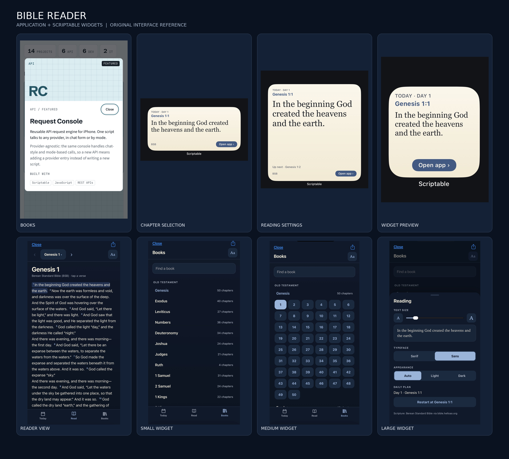

# Bible Reader

A cross-platform Bible reader with a standalone web app, daily reading plan, and optional iOS widgets powered by Scriptable.

**Release status:** implementation prepared; production verification is pending. GitHub Pages was not enabled at the inspected baseline. The web address below is a deployment target until Pages has been configured and verified.

[Web Reader — deployment target](https://general-aca-5843.github.io/bible-reader/) · [Source](https://github.com/General-aca-5843/bible-reader) · [iPhone Widgets](#iphone-widgets)

## Web Reader

- All 66 BSB books, Old and New Testament sections, book search, and expandable chapter selection.
- Numbered Scripture, previous/next chapter controls, swipe navigation, verse selection, and copying.
- Today starts at Genesis 1:1 and advances one verse per local calendar day, catches up after missed days, and wraps after Revelation. It is not random. Restart the plan or start at a selected verse.
- Reading settings: 14–36 px text, serif/sans typeface, and automatic/light/dark appearance.
- Saves reading location, reading scroll offset, active view, preferences, and daily progress locally.
- Caches downloaded Scripture and adjacent chapters. Loading failures offer retry; cached chapters remain usable when a request fails.
- One navigation component: bottom tabs on phones, compact horizontal navigation on tablets, and a 240 px left sidebar from 1024 CSS px.
- Keyboard-operable verse controls, dialog focus management, reduced-motion styling, and safe-area padding.

`index.html` contains all application HTML, CSS, JavaScript, and SVG icons. It has no framework, package installation, build step, backend, or external UI assets. Scripture is fetched from HelloAO.

## Installation and use

### Browser

After publication, open the Web Reader link in a modern browser. Choose **Books**, expand a book, then select a chapter. **Today** shows the sequential daily verse. **Aa** opens Reading settings. Tap or keyboard-select a verse for **Copy** or **Start plan here**.

For local development, serve this repository with any static HTTP server and open `index.html`. HTTPS is recommended for publication and is needed for normal clipboard access. Opening a downloaded HTML file directly may restrict storage, fetching, or clipboard access depending on the browser.

### iPhone Widgets

1. Install [Scriptable](https://scriptable.app/) on your iPhone.
2. Open [Bible.js](Bible.js), copy the complete source into a new Scriptable script, and name it **Bible**. Preserve the metadata lines at the top.
3. Run the script once while online to initialize the reader, daily plan, and cache.
4. Add a Scriptable widget to your Home Screen, choosing small, medium, or large.
5. Edit the widget and select the **Bible** script. Tap its open control to read the verse in context.

The original companion also includes extra-large and Lock Screen accessory rendering paths where supported by Scriptable/iOS. Widget refresh timing is controlled by iOS; the script requests refresh shortly after midnight. Small, medium, and large widget execution has **not been tested on an iPhone for this release**.

Use the browser, Scriptable, or both. They are independent: browser data does not automatically synchronize with Scriptable. Scriptable stores its settings, position, plan, and cache in its local documents directory under `Bible/`.

## Repository and references

| File | Purpose |
| --- | --- |
| `index.html` | Self-contained browser reader |
| `Bible.js` | Original 606-line Scriptable companion, preserved without source changes |
| `README.md` | Usage, attribution, deployment, and limitations |
| `screenshots/Bible_Reader_Screenshot_Grid.png` | Supplied reference grid, unchanged |

The supplied grid contains mislabeled panels and one unrelated Request Console image. It is retained as supplied; actual Bible Reader screenshots embedded in the coordinator handoff and the original source were used to guide implementation. This grid is a reference asset, not proof of the new browser application's test results.

## Scripture API and attribution

Scripture: **Berean Standard Bible (BSB)** via the [HelloAO Free Use Bible API](https://bible.helloao.org/docs/). The provider and translation are unchanged.

- Books: `https://bible.helloao.org/api/BSB/books.json`
- Chapters: `https://bible.helloao.org/api/BSB/{BOOK}/{CHAPTER}.simple.json`

The [Berean publisher's terms](https://berean.bible/terms.htm) dedicate the text to the public domain. The API response also identifies BSB as public domain. Berean Standard Bible is produced in cooperation with Bible Hub, Discovery Bible, OpenBible.com, and the Berean Bible Translation Committee. No API key is used. Browser requests go directly to HelloAO; no reading preferences are uploaded by this application.

## Browser requirements and limitations

Modern Safari, Chrome, Edge, or Firefox with JavaScript, Fetch, CSS Grid, media queries, and localStorage support is expected. Cross-browser/device compatibility is not yet verified. Clipboard operations require browser permission/support; failure is reported without claiming the text was copied.

Uncached Scripture needs Internet access. The application is not a fully offline-installable PWA: there is no service worker, and reopening the hosted HTML itself offline depends on the browser cache. Stored chapters are a best-effort cache, not a downloaded full Bible. Storage denial or exhausted quota produces a warning; changes may then survive only for the current visit. Clearing browser site data removes its preferences and progress.

The interface preserves the source's settings. There was no adjustable line-spacing preference in the original script, so none has been invented. The browser uses its own navigation chrome; Scriptable's native Close/Share controls are not part of the web app.

## Verification status — November 1, 2026

JavaScript syntax checks and automated DOM/logic tests were run against saved responses fetched from the actual HelloAO BSB API. These tests cover book/chapter rendering, navigation, daily progression and wrap, preferences and position restoration, copying, keyboard handlers, dialog focus, offline cache, storage denial, and error/retry behavior. Tests use a DOM emulator; they do not establish visual layout, touch-device behavior, or real-browser compatibility.

The books endpoint returned HTTP 200 and `Access-Control-Allow-Origin: *` for the intended Pages origin. This is header evidence, not a completed in-browser CORS test.

Still required before production sign-off:

- Rendered viewport checks at 320, 375, 390, 430, 768, 834, 1024, 1280, and 1440 CSS px; compare mobile appearance, sidebar placement, overflow, and state/scroll retention on resize.
- Real-browser Fetch/CORS, clipboard, persistence, keyboard and touch checks; Safari/iPhone testing.
- Original Scriptable reader and small/medium/large widget execution on iPhone.
- GitHub Pages configuration, build result, live page and asset verification, and live interaction checks.

## GitHub Pages configuration

In this repository, open **Settings → Pages**:

1. Under **Build and deployment**, set **Source** to **Deploy from a branch**.
2. Set **Branch** to **main** and folder to **/(root)**.
3. Save. Leave the custom domain empty.
4. Wait for the Pages deployment to complete, then verify `https://general-aca-5843.github.io/bible-reader/` and repeat the live functional checks above.

The app uses no root-relative local assets and is intended to work under `/bible-reader/`. A successful source commit does not prove a successful deployment.

## Rollback

The verified preimplementation baseline is `376fe287913a997f06fab9dc3dc46f549846559f` (initial commit). It contains only the original README.

To undo this implementation while preserving history, revert the implementation commit on a review branch, inspect the diff, and merge the reviewed revert into `main`. Do not reset or force-push shared history. If Pages has been enabled, verify the resulting publication separately; reverting to the README-only baseline removes the reader. Local browser data is independent of repository rollback.
